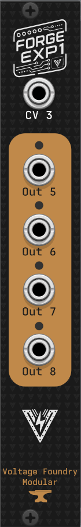

# Forge Expander 1: Four More Outputs, One More Input

## Overview

**Forge Expander 1** is a 4 HP companion module for the **Forge** series. It adds
four output jacks and one CV input jack to a host module, connected by a ribbon
cable to the expansion header on the back of the host and powered from it.

Because it is powered and driven entirely through the ribbon cable, the expander
doesn't need power of its own.

## Compatible modules

| Module                                               | What the extra jacks do                                                                                   | Details                                                            |
| ---------------------------------------------------- | --------------------------------------------------------------------------------------------------------- | ------------------------------------------------------------------ |
| [Clock Forge](https://vfmod.com/modules/clockforge/) | Outputs 5-8 become four more full clock/waveform/envelope outputs; CV 3 becomes a third modulation source | [Expander section](https://vfmod.com/modules/clockforge/#expander) |

Support is per-firmware. A Forge module not listed here either ignores the
expander or has not been updated for it yet — fitting one to such a module is
harmless, the jacks simply stay silent.

## Front panel

| Jack                       | Direction | Range      |
| -------------------------- | --------- | ---------- |
| **5**, **6**, **7**, **8** | Output    | 0-5 V      |
| **CV 3**                   | Input     | -5 to +5 V |

The panel is numbered as a _continuation of the host_: a host with four output
jacks of its own sees these as outputs 5 to 8, and a host with two CV inputs of
its own sees the input as CV 3. Where a host counts its jacks differently in its
own manual, that manual says so — Clock Forge, for example, calls this jack
**IN 4** in its jack sequence and **CV 3** in its menus.

The output stages are the same as the host's: a second quad 12-bit DAC, its own
output op-amps, and its own set of calibration trimmers. The input stage is
identical to the host's other CV inputs.

## Fitting one

1. Power the host module down.
2. Connect the ribbon cable between the host's expansion header and the header
   on the expander. **Check the marking of the cable stripe on the PCBs**.
3. Mount the expander in the case. It can sit on either side of the host; the
   ribbon is the only connection, so the two do not need to be adjacent.
4. Power up and enable the expander in the host's settings, if the host asks for
   it. Some hosts detect it automatically; Clock Forge has a **SETTINGS →
   EXPANDER** entry that has to be set.
5. Calibrate the expander outputs using the host module's calibration wizard.

### Calibrate it

The expander's outputs have their own trimmers and its input has its own stage,
so they need their own calibration measurements — the host's factory numbers do
not carry over.

Re-run the host module's calibration wizard after fitting one. The wizard probes
the expander at startup, and grows to cover the extra jacks when it finds one.
See the host module's _Hardware Calibration_ section for the procedure.

## In VCV Rack

The expander is a separate module in the Rack browser, listed under the same
plugin as its host. Place it on either side of a compatible module and the two
connect automatically. It needs to be placed right after or before the host module
to work.

Compatible hosts also offer an **Add Expander 1** entry in their right-click
menu, which places the expander and switches the host's expander setting on in
one step.

## Troubleshooting

**The extra jacks stay silent.** Check that the host's expander setting is
enabled, and that the ribbon cable is seated at both ends. A host left with its
expander setting off behaves exactly as if no expander were fitted.

**Output voltages are off.** Run the host's calibration wizard — a freshly
fitted expander is uncalibrated until you do.

**The host does not detect it.** The expander's DAC is found by an address probe
at boot. Power-cycle the host after connecting the cable; the probe runs once at
startup, not continuously.

## Specifications

- **Power Supply**: from the host module, over the ribbon cable
- **Input CV Range**: -5 to +5 V
- **Output CV Range**: 0-5 V
- **Resolution**: 12-bit
- **Dimensions**: 4 HP
- **Requires**: a compatible Forge series host module

## Contact

For support and inquiries, please open an issue on the [GitHub repository](https://github.com/VoltageFoundryMod/ForgeSeries).

## License

Source code is GPL-3.0-or-later — see the
[LICENSE](https://github.com/VoltageFoundryMod/ForgeSeries/blob/main/LICENSE) in the source repository.

Panel designs, graphics, module names and the Voltage Foundry Modular brand are
copyright and are not covered by that licence; see
[LICENSE-ASSETS.md](https://github.com/VoltageFoundryMod/ForgeSeries/blob/main/LICENSE-ASSETS.md).
